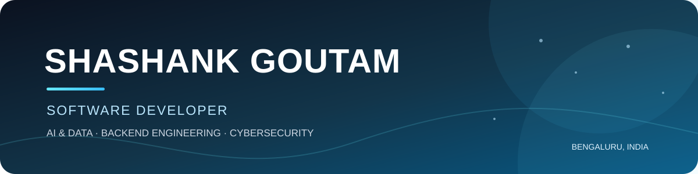

<!--
  GitHub Profile README
  Dynamic third-party statistics images were removed to avoid broken embeds.
-->

  

  

    
    
    
  

  

    
  

  <h3>Building useful software. Exploring intelligent systems. Learning every day.</h3>

  

    I'm a software developer from <b>Bengaluru, India 🇮🇳</b>, interested in backend engineering,
    machine learning, data analytics, and cybersecurity. I enjoy turning ideas into practical
    applications and learning how systems work under the hood.
  

---

## 👨‍💻 About Me

- 🔭 Building and improving software projects, including [Employee Management (Spring Boot)](https://github.com/ShashankGoutam/EmployeeManagement_SpringBoot) and [Expense Tracker](https://github.com/ShashankGoutam/Expense_Tracker).
- 🌱 Exploring **Machine Learning, PyTorch, and Cloud AI services**.
- 🧠 Interested in backend development, data-driven applications, AI, and cybersecurity.
- 💬 Ask me about Python, JavaScript, Java, data analytics, and transfer learning.
- 📍 Bengaluru, India.

## 🧰 Tech Stack

<b>Languages</b>

  

<b>Frameworks & Libraries</b>

  
  

<b>Data, Databases & Tools</b>

  
  

## 🚀 Featured Projects

<table>
  <tr>
    <td width="50%" valign="top">
      <h3>☕ Employee Management — Spring Boot</h3>
      
A Java and Spring Boot project focused on employee management.

      <a href="https://github.com/ShashankGoutam/EmployeeManagement_SpringBoot">View repository →</a>
    </td>
    <td width="50%" valign="top">
      <h3>💸 Expense Tracker</h3>
      
A project for tracking and managing expenses.

      <a href="https://github.com/ShashankGoutam/Expense_Tracker">View repository →</a>
    </td>
  </tr>
</table>

## 📈 GitHub Activity

  
  

    

  

  

    <a href="https://github.com/ShashankGoutam">
      <b>View my live contribution calendar and activity on GitHub →</b>
    </a>
  

## 🤝 Let's Connect

  
  
  

  <i>Thanks for stopping by. Have a great day! ✨</i>

